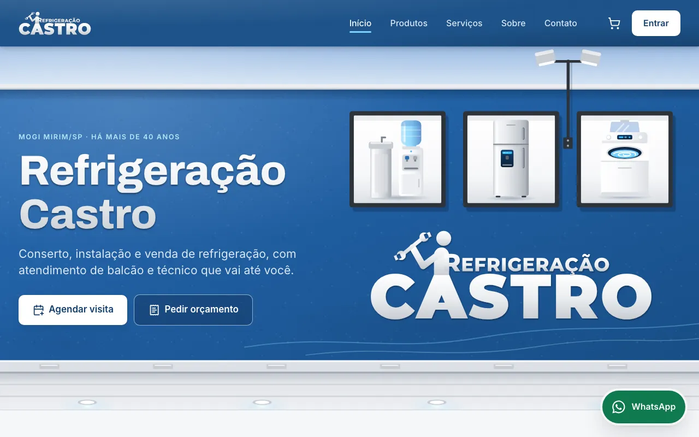
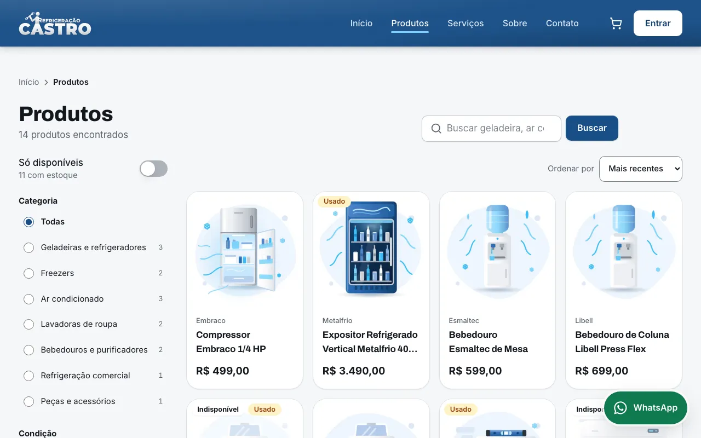
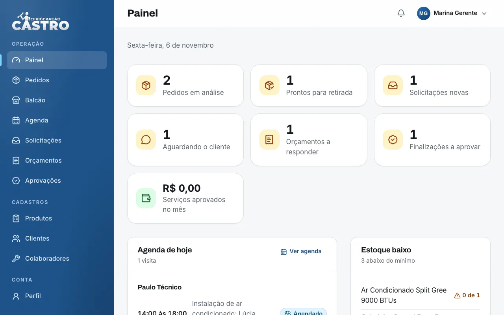

# Refrigeração Castro

Sistema da Refrigeração Castro, loja de família em Mogi Mirim/SP que conserta geladeiras, freezers, lavadoras e ar condicionado desde 1990. Em um só lugar o sistema reúne o site da loja, a loja online com retirada no balcão, os pedidos de visita técnica e de orçamento, a agenda dos técnicos e o painel da equipe. O código é aberto (licença MIT) e pode servir de ponto de partida para outras lojas do segmento.

<p align="center">
  
</p>

## O que o sistema faz

* **Clientes** criam a conta, compram produtos novos e usados para retirar na loja, pedem visita técnica com fotos do problema e as datas que ficam boas, pedem orçamentos e acompanham tudo em Minha conta.
* **Colaboradores** (técnicos) veem a visita do dia no celular, finalizam o serviço com fotos e fazem vendas no balcão.
* **Gerentes** cuidam da fila de pedidos, aprovam solicitações, montam a agenda, respondem orçamentos, cadastram produtos e acompanham os indicadores do painel.
* **O super usuário** cadastra a equipe, configura a loja, organiza categorias e tipos de serviço e consulta a trilha de auditoria.

O passo a passo de cada papel, com imagens, está no [manual do usuário](docs/MANUAL.md).

## Telas

| Página inicial | Catálogo | Painel da equipe |
|---|---|---|
|  |  |  |

## Tecnologias

* **API:** Node.js 24, Fastify 5, Zod com OpenAPI 3.1 gerada, Drizzle ORM, PostgreSQL 17, Argon2id, JWT com refresh rotativo, Nodemailer, sharp e um worker com outbox no próprio banco.
* **Site:** Nuxt 4, Vue 3, Tailwind CSS v4, Reka UI, Pinia, FullCalendar e cliente da API tipado a partir da OpenAPI.
* **Qualidade:** TypeScript estrito, ESLint, Prettier, dependency cruiser, Vitest com 100% de cobertura, Playwright em celular, tablet e desktop, axe, Lighthouse CI, Schemathesis e teste de carga com k6.
* **Entrega:** imagens Docker da API (com o worker) e do site, Docker Compose e Caddy com HTTPS automático.

A arquitetura está em [docs/ARQUITETURA.md](docs/ARQUITETURA.md) e as decisões em [docs/adr](docs/adr/README.md).

## Como executar

Requisitos: Node.js 24.11 ou mais recente, pnpm 12 (vem pelo Corepack do Node), Docker com Compose e Git.

### macOS

1. Instale o [Docker Desktop](https://www.docker.com/products/docker-desktop/) e abra o aplicativo uma vez.
2. Instale o Node.js 24 pelo [site oficial](https://nodejs.org) ou com `brew install node@24`.
3. No terminal:

```
corepack enable
git clone https://github.com/renanleonellocastro/loja_de_refrigeracao.git
cd loja_de_refrigeracao
pnpm install
pnpm dev
```

### Linux

1. Instale o Docker Engine com o plugin Compose seguindo o [guia da sua distribuição](https://docs.docker.com/engine/install/) e coloque seu usuário no grupo `docker` (`sudo usermod -aG docker $USER`, depois saia e entre de novo).
2. Instale o Node.js 24 pelo [nvm](https://github.com/nvm-sh/nvm) (`nvm install 24`) ou pelo pacote da [NodeSource](https://github.com/nodesource/distributions).
3. Rode os mesmos comandos do macOS a partir de `corepack enable`.

### Windows (WSL)

1. No PowerShell como administrador, rode `wsl --install`, reinicie e crie o usuário do Ubuntu.
2. Instale o [Docker Desktop](https://www.docker.com/products/docker-desktop/) e, em Settings, Resources, WSL integration, ligue a integração com o Ubuntu.
3. Abra o terminal do Ubuntu e instale o Node.js 24 pelo [nvm](https://github.com/nvm-sh/nvm) (`nvm install 24`).
4. Clone o projeto dentro do Linux (por exemplo em `~/loja_de_refrigeracao`), não em `/mnt/c`, porque lá a instalação e o recarregamento ficam muito lentos. Depois rode os mesmos comandos do macOS a partir de `corepack enable`.
5. Abra os endereços abaixo no navegador do Windows normalmente; o WSL repassa as portas.

### O que o `pnpm dev` faz

O comando cria o `.env` a partir de `infra/env.sample`, sobe o PostgreSQL e o Mailpit no Docker, compila os pacotes, aplica as migrações, carrega os dados de exemplo e inicia a API, o worker e o site.

* Site: http://localhost:3000
* API: http://localhost:3001 (documentação navegável em `/api/docs`)
* Emails enviados em desenvolvimento: http://localhost:8025

Contas de exemplo, todas com a senha `Castro-Dev-2026`: `admin@castro.dev` (super usuário), `gerente@castro.dev`, `tecnico@castro.dev` e `cliente@castro.dev`.

Os dados de exemplo trazem produtos com fotos e clientes com pedidos, orçamentos e solicitações de serviço em todos os estados, com visitas na agenda de hoje e de amanhã, para que cada tela já abra com conteúdo. Os clientes extras (`joao.pereira`, `maria.souza`, `lucia.andrade` e `bar.do.ze`, todos `@castro.dev`) usam a mesma senha. As datas são relativas ao dia em que o seed rodou; para recomeçar do zero, rode `docker compose -f infra/compose.yaml down -v` (apaga o banco local) e depois `pnpm dev` de novo.

Para produção, veja o [guia de operação](docs/OPERACAO.md).

## Como testar

```
pnpm lint          # ESLint e Prettier
pnpm typecheck     # TypeScript em todos os pacotes
pnpm depcruise     # fronteiras entre os módulos da API
pnpm test          # unitários e integração com PostgreSQL real, cobertura de 100%
pnpm test:e2e      # Playwright em celular, tablet e desktop, com axe
```

Os testes de integração usam o PostgreSQL do `pnpm db:up`. Detalhes em [docs/TESTES.md](docs/TESTES.md) e em [CONTRIBUTING.md](CONTRIBUTING.md).

## Documentação

* [Manual do usuário por papel](docs/MANUAL.md)
* [Guia de operação: deploy, backups e monitoramento](docs/OPERACAO.md)
* [A loja: história, dados e serviços](docs/LOJA.md)
* [Requisitos](docs/REQUISITOS.md), [casos de uso complementares](docs/CASOS_DE_USO_NOVOS.md) e a [definição original](definicao.md)
* [Modelo de domínio](docs/DOMINIO.md), [arquitetura](docs/ARQUITETURA.md) e [API REST](docs/API.md)
* [Identidade visual e design system](docs/DESIGN.md)
* [Testes](docs/TESTES.md) e [segurança](docs/SEGURANCA.md)
* [Decisões de arquitetura (ADRs)](docs/adr/README.md)
* [Roteiro de milestones](docs/ROTEIRO.md) e [diagnóstico do protótipo de 2022](docs/DIAGNOSTICO.md)

## Quer contribuir?

O projeto é aberto e toda contribuição é bem vinda. As tarefas ficam nas [issues](https://github.com/renanleonellocastro/loja_de_refrigeracao/issues); leia o [CONTRIBUTING.md](CONTRIBUTING.md), escolha uma, faça o fork e abra um pull request.
